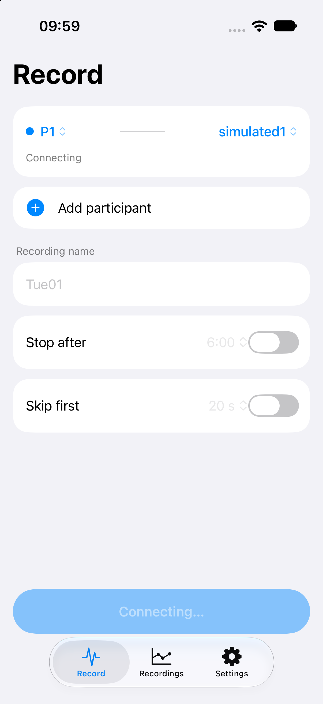

# ECG Recorder

iPhone app (iOS 17+, portrait) that records up to 6 Polar H10 straps at once, shows live heart rate and RMSSD, and saves one CSV per session on the device. Fully offline, built for physiological-computing research.



## Build

Requires Xcode 16+, [XcodeGen](https://github.com/yonaskolb/XcodeGen) (`brew install xcodegen`) and an Apple ID for signing.

```sh
xcodegen generate
open ECGRecorder.xcodeproj
```

Change the placeholder bundle ID (`com.example.ecgrecorder`) in `project.yml` to your own and pick your team in Xcode. The Simulator uses simulated devices; Bluetooth needs a real iPhone.

## Test

```sh
tools/test.sh          # logic tests on the Mac, about 12 s
tools/test.sh --sim    # full suite on the iOS Simulator
```

## Tools

- `tools/unpack_ecg.py`: expands a session CSV to one row per ECG sample.
- `tools/signal_quality.py`: artifact share and ECG kurtosis of a CSV.

## License

MIT
